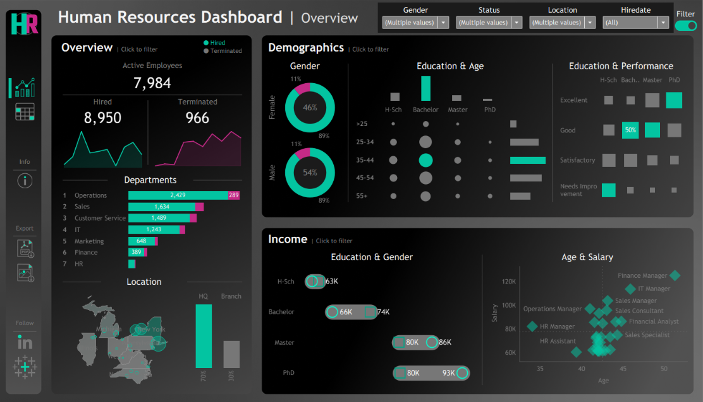
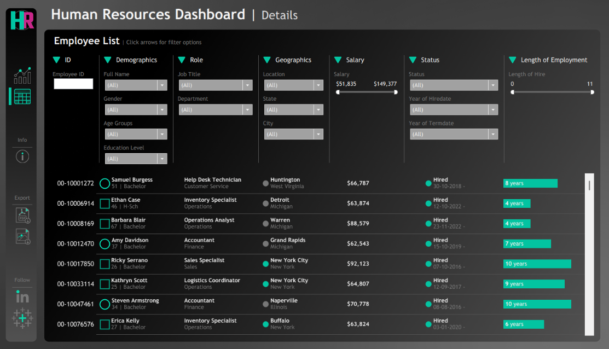

# HR Analytics Dashboard | Tableau

An interactive HR analytics dashboard built using Tableau to explore employee demographics, workforce distribution, salary trends, hiring, and employee attrition.

## Dashboard Preview

### Overview Dashboard

### Details Dashboard

## Project Overview

This project focuses on analysing human resources data through interactive Tableau dashboards, making it easier to monitor workforce composition, understand employee demographics, compare salary patterns, and explore hiring and termination trends.

## Key Features

- **Employee KPIs:** Displays Active Employees, Hired Employees, and Terminated Employees.
- **Hiring & Termination Analysis:** Visualizes employee hiring and termination trends.
- **Department Analysis:** Compares employee distribution across different departments.
- **Demographic Analysis:** Explores employee distribution by gender, age groups, and education levels.
- **Education & Performance Analysis:** Examines employee performance across different education levels.
- **Location Analysis:** Visualizes employee distribution across geographical locations.
- **Income Analysis:** Explores salary patterns based on education, gender, age, and job roles.
- **Employee Details:** Provides an interactive employee list with filters for demographics, job roles, location, salary, employment status, and length of employment.

## Tools Used

- Tableau
- Microsoft Excel
- Data Visualization
- Human Resources Analytics
- Data Analysis

## Files Included

- `HR Dashboard.twbx` — Tableau packaged workbook.
- `dataset.csv` — Source dataset.
- `Screenshot 2026-11-08 131233.png` — Overview dashboard preview.
- `Screenshot 2026-11-08 131322.png` — Employee details dashboard preview.

## How to View the Dashboard

1. Download the `.twbx` file from this repository.
2. Open it using Tableau Desktop.
3. Explore the Overview and Details dashboards.
4. Interact with the filters and visualizations to analyse employee data.

## Learning Outcomes

This project provided practical experience in analysing HR data, creating interactive dashboards, exploring workforce demographics, understanding employee trends, and presenting business insights through Tableau.

---

**Project:** HR Analytics Dashboard  
**Created by:** Hammad Kazi
